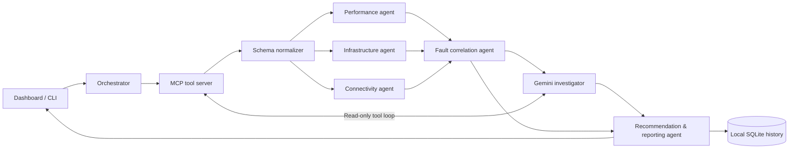

# NetCoop AI

**From scattered network signals to one evidence-backed diagnosis.**

A complete local hackathon prototype for multi-agent campus network fault diagnosis. Includes a responsive dashboard, interactive 3D agent workflow, real MCP transport, optional Google Gemini tool use, reproducible sample scenarios, incident history, CLI and tests. Adapted from the supplied NetCoop prototype; original telemetry fixtures and baseline rules are retained in `legacy_rules.py` with stricter validation and orchestration around them.

## Start in two minutes

Requires **Python 3.11+**. Tested on Windows with Python 3.14. First-time installation needs internet access.

On Windows, double-click **run.bat**. It creates a project-local environment, installs the pinned dependencies and starts the server. Then open **http://127.0.0.1:8000**. Keep the terminal open; Ctrl+C stops the application.

Or run from the project directory:

```powershell
python -m venv .venv
.venv\Scripts\python.exe -m pip install -r requirements.txt
.venv\Scripts\python.exe -m uvicorn server:app --host 127.0.0.1 --port 8000
```

macOS/Linux:

```sh
python3 -m venv .venv
.venv/bin/python -m pip install -r requirements.txt
.venv/bin/python -m uvicorn server:app --host 127.0.0.1 --port 8000
```

No Node build, cloud account, GPU or API key is needed for deterministic demo mode. Optional Google Fonts fall back to installed system fonts offline. The spatial workflow renderer has no external JavaScript dependency.

## Enable Google Gemini

1. Obtain your own API key from [Google AI Studio](https://aistudio.google.com/apikey).
2. Copy `.env.example` to `.env` in the project directory.
3. Set `GEMINI_API_KEY=your_key`. Leave `GEMINI_MODEL=gemini-flash-latest`, or use a model enabled for your account that supports the Gemini `generateContent` function-calling API.
4. Restart the server. Select **Google Gemini + MCP tools** and run an investigation.

The key is used only on the server. Never put it in `static/app.js`, commit `.env`, or share it in a demo recording. Gemini mode sends the current telemetry and scored decision to Google's API. Offline mode never calls Google. API errors, missing keys, quotas, blocked responses and exhausted budgets are visibly labelled; they do not fabricate an LLM response or discard the deterministic report.

**Live Google calls have not been verified with a real key in this delivery.** The multi-turn tool protocol, function response IDs, thought-signature preservation and failure fallback are exercised using a mocked Google transport. Account/model availability must be checked using your key before the presentation.

## What to demonstrate

Start with **Hostel uplink congestion**. Watch the three specialist agents exchange findings through MCP. Inspect an event in the message stream, review device-level evidence and export the report. Then demonstrate legacy schema conversion, insufficient evidence with missing or stale data, and malformed input rejection. Enable Gemini to show model-selected MCP device inspection or runbook lookup when available. See `DEMO_SCRIPT.md` for a timed four-minute presentation.

## Agent architecture



| Component | Responsibility | Implementation |
|---|---|---|
| Orchestrator | Plan, tool discovery, parallel specialist dispatch, error isolation, final consolidation | `engine.py` |
| Normalizer | Legacy unit conversion, types/ranges, duplicate IDs, topology, timestamps, coverage | `netcoop.py` |
| Performance agent | Latency, jitter, packet loss, throughput and bandwidth evidence | `netcoop.py` / baseline rules |
| Infrastructure agent | CPU, memory, device state, interfaces, link utilization and queue drops | `netcoop.py` / baseline rules |
| Connectivity agent | Wireless RSSI, retransmissions, DNS/DHCP, down-device adjacency | `netcoop.py` / baseline rules |
| Fault correlation agent | Evidence aggregation, competing explanations, confidence and abstention | `netcoop.py` |
| Gemini investigator | Select read-only tools, inspect returned evidence, produce advisory explanation | `engine.py` |
| Reporting agent | Unified report, evidence attribution, uncertainty, actions for human review | `engine.py` |

These are functional hybrid agents, not separate LLM calls disguised as specialists. Each specialist has distinct inputs of interest, analysis and structured findings. The orchestrator concurrently dispatches all three over a real MCP session; the correlation agent interprets their findings. Deterministic agents give repeatable diagnostic behavior, while Gemini supplies optional adaptive investigation. The model cannot overwrite measured values, scored cause or confidence.

### Agentic loop and bounds

1. Plan the investigation and discover MCP tools.
2. Read or accept telemetry; normalize and validate it through MCP.
3. Dispatch three specialists concurrently with isolated failure handling.
4. Correlate findings and rank causes.
5. In Gemini mode: observe the evidence → select a tool → validate the call → execute via MCP → return tool observations → continue reasoning.
6. Stop after a final model answer, four model turns or six tool calls.
7. Retrieve corrective-action guidance and compile the immutable evidence report.

Gemini has a restricted allowlist (`inspect_device`, `get_runbook`). Its requests never execute shell commands or change network infrastructure. Recommendations are for human review. The investigator's extra context improves the explanation but is not rescored as new telemetry.

### MCP tools

The project uses **MCP Python SDK 2.3.0**, where `MCPServer` is the server class and result fields use snake_case.

| Tool | Input | Output |
|---|---|---|
| `get_telemetry` | scenario, seed | Synthetic telemetry snapshot |
| `normalize_telemetry` | raw JSON object | Canonical telemetry + quality metadata |
| `analyze_specialist` | agent name, normalized telemetry | Findings + per-cause support weights |
| `inspect_device` | device ID, normalized telemetry | Device and adjacent links |
| `get_runbook` | cause | Corrective actions + non-execution notice |

Resource `netcoop://protocol` describes the message envelope and units. Run `python mcp_server.py` to expose the tools to another MCP client. The server waits for JSON-RPC on stdio; it is not a normal interactive command. The dashboard launches its own subprocess per investigation automatically.

Example external-client configuration (replace the paths with your extracted folder and environment):

```json
{
  "mcpServers": {
    "netcoop": {
      "command": "C:/path/to/netcoop-ai/.venv/Scripts/python.exe",
      "args": ["C:/path/to/netcoop-ai/mcp_server.py"]
    }
  }
}
```

## Interoperability contract

Full details and an example are in `PROTOCOL.md`.

Every message carries `schema`, `msg_id`, `run_id`, `sequence`, `ts`, `sender`, `recipient`, `type`, and `payload`. Findings include `signal`, `value`, `unit`, `severity`, `interpretation` and optional `device`. The final report also records the contributing `source` agent. All agents share canonical measurements: milliseconds, percentages, Mbps, dBm, packets/second, and counts.

Schema 1.0 is accepted directly. Legacy 0.9 uses `nodes`, `kpi`, fractional CPU/utilization/loss, and second-based latency/jitter. These are converted and the conversion is disclosed. Unknown versions and invalid numeric values are rejected. Missing values remain unknown rather than being replaced by zero.

## Diagnostic confidence

Weights are explicit heuristic support, not learned probabilities. The formula is:

```text
base = 0.5 * top / (top + second) + 0.5 * min(top / 1.2, 1)
coverage = fraction_of_present_core_fields * successful_specialists / 3
confidence = base * coverage * (0.5 if timestamp_is_stale_or_missing else 1)
```

When no abnormal evidence exists, the base is 0.9. This becomes a healthy baseline only if data is sufficiently complete and fresh and enough specialists succeeded. A score below the evidence threshold (top <0.4), coverage <0.65, stale/missing/future timestamp, or close competing scores (gap <0.35) produces `insufficient_evidence`; confidence is capped at 0.49. No successful agents therefore cannot produce a healthy result. The coverage denominator includes five network metrics and five core fields per device.

Freshness is measured against server time: older than five minutes or more than one minute in the future is invalid for a current diagnosis. Included JSON samples are timestamped snapshots and will become stale deliberately. Select a scenario in the UI or run `make_samples.py` to generate fresh inputs. Do not disable freshness checks just to get a higher score.

Affected devices are those with abnormal device-local evidence. Adjacent nodes are separately labelled **potentially impacted**, based on topology; impact is not asserted as observed. Network-wide loss alone does not localize a device. DNS/DHCP can be diagnosed without inventing a server device ID.

## API and CLI

| Route | Purpose |
|---|---|
| `GET /api/health` | Local service and key-configuration status; not an assertion of live Google connectivity |
| `GET /api/scenarios` | Supported deterministic scenarios |
| `GET /api/telemetry/{scenario}` | Fresh synthetic input |
| `POST /api/diagnose` | Complete diagnosis result |
| `POST /api/diagnose/stream` | Live newline-delimited JSON events |
| `GET /api/incidents` | Latest 20 reports |
| `GET /api/incidents/{id}` | Saved report, telemetry and event trace |
| `/docs` | Generated OpenAPI documentation |

Request: `{"scenario":"congestion","seed":7,"mode":"demo"}`. For custom data use `{"telemetry":{...},"mode":"demo"}`. Invalid scenario/options use HTTP 422. Valid requests containing incompatible telemetry return a structured `status: "error"` report. The stream emits `message`, then `complete`, or a service-level `error`. History retains the latest 100 investigations locally in `data/incidents.sqlite3`.

```sh
python cli.py --scenario weak_wifi --output report.json
python cli.py --scenario congestion --gemini
python cli.py --input samples/interop_legacy.json
python make_samples.py
python -m pytest -q
```

## Tests and scope

Tests cover expected diagnoses, numeric ranges/types, legacy conversion, non-mutation, malformed schemas, duplicate IDs, invalid topology, unknown services, agent failure, competing explanations, actual MCP subprocess diagnosis, streamed HTTP responses, persistence, mocked Gemini function calls, preserved signatures and fallback behavior.

This is a **local prototype**, not a production monitoring or remediation platform. It uses synthetic or uploaded data rather than campus SNMP/NETCONF collectors. History is durable, but interrupted runs are not resumable. There is no multi-user authentication or tenant isolation; keep the default loopback binding. It does not automatically publish a GitHub repository or record a video. A repository-ready source package and demo script are provided for those submission steps.

## Project map

```text
server.py             HTTP API, stream, history, static dashboard
engine.py             Orchestrator, MCP client, Gemini investigation loop
netcoop.py            Validation, specialists, correlation, uncertainty
legacy_rules.py       Adapted original scenario generator and baseline rules
mcp_server.py         MCP tool/resource server
cli.py                Command-line diagnosis
make_samples.py       Fresh reproducible sample fixtures
static/               HTML, CSS, dependency-free spatial renderer
samples/              Eleven sample input scenarios
tests/                Reproducible unit and integration tests
PROTOCOL.md           Message and telemetry contracts
DEMO_SCRIPT.md        Four-minute judging demonstration
VALIDATION.md         Verification record and remaining live-key check
```

## Official integration references

- [Google Gemini function calling](https://ai.google.dev/gemini-api/docs/function-calling)
- [Google generateContent API](https://ai.google.dev/api/generate-content)
- [MCP Python SDK](https://py.sdk.modelcontextprotocol.io/)

## Troubleshooting

- **Cannot import MCPServer:** use this project's pinned requirements in its own environment. MCP 1.x uses a different class/API.
- **Gemini unavailable:** check the server's `.env`, restart it, verify account quota/model access, and retry. The dashboard exposes a safe error category instead of credentials or raw error bodies.
- **Page is blank when opening index.html:** serve it with Python; API requests require the local web server.
- **Port already in use:** change `--port 8000` to `--port 8001` and open the matching URL.
- **Imported sample reports stale:** regenerate samples or use a scenario to get a current timestamp.
- **MCP subprocess startup fails:** verify that the same Python interpreter can import `mcp`, and keep `mcp_server.py` beside `engine.py`.
