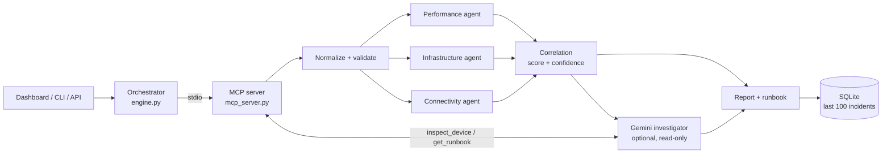

# NetCoop AI

**Multi-agent network fault diagnosis that shows its evidence, and says "not enough data" when that is the honest answer.**

NetCoop AI takes campus network telemetry (device health, link metrics, DNS/DHCP status), runs three independent specialist agents over it, and produces a diagnosis with ranked alternatives, a confidence score, the evidence behind it, and human-review recommendations. It never changes the network. Every step is streamed live as structured messages over a real MCP (Model Context Protocol) connection.

Built for the Agentic AI hackathon around a campus-network scenario (IIT Bhubaneswar). All bundled telemetry is **synthetic**.

---

## Why it is different

| Principle | What the code does |
|---|---|
| **Evidence first** | Every finding carries a signal, value, unit, severity, device and interpretation. The report lists them all. |
| **Honest uncertainty** | Missing, stale or conflicting data produces `insufficient_evidence` with confidence capped below 0.5, never a confident guess. |
| **Independent agents** | Performance, infrastructure and connectivity specialists analyse the same normalized data in parallel and never read each other's output. |
| **Real MCP transport** | Each run spawns an MCP server subprocess over stdio. All tool calls go through it. |
| **AI cannot override facts** | Optional Gemini investigation is advisory, read-only, budget-limited, and cannot change the scored diagnosis. |
| **Schema interoperability** | Legacy schema `0.9` is converted to `1.0` automatically and every conversion is logged as a warning. |
| **Recommendations only** | Runbooks suggest human actions. Nothing is executed. |

---

## How it works



1. **Plan.** The orchestrator opens an MCP session and lists the available tools.
2. **Telemetry.** It reads a synthetic scenario (`get_telemetry`) or uses telemetry you supply.
3. **Normalize.** `normalize_telemetry` validates the schema (types, ranges, unique IDs, valid links), converts legacy units, and scores **data coverage** and **freshness**.
4. **Specialists, in parallel.**
   - *Performance*: latency, jitter, packet loss, throughput vs. capacity.
   - *Infrastructure*: link utilization, queue drops, interface errors, CPU, memory, device status.
   - *Connectivity*: Wi-Fi signal and retransmissions, DNS/DHCP health, impact of down devices.
5. **Correlate.** Each specialist returns weighted support for candidate causes. Weights are summed, ranked, and turned into a confidence value. The result is downgraded to `insufficient_evidence` if coverage is low, data is stale, total support is weak, or the top two causes are too close.
6. **Investigate (optional).** Gemini can call two read-only MCP tools, `inspect_device` and `get_runbook`, within a hard budget (4 model turns, 6 tool calls).
7. **Report.** The final report is saved to SQLite and streamed to the client.

### Diagnoses it can produce

`link_congestion` · `weak_wifi` · `interface_fault` · `dns_dhcp_failure` · `device_overload` · `normal` · `insufficient_evidence`

### Detection thresholds

| Signal | Triggers when | Points toward |
|---|---|---|
| Link utilization | > 85 % | link congestion |
| Queue drops | > 50 pkts/s | link congestion |
| Latency | > 100 ms | link congestion |
| Throughput / bandwidth | > 0.85 | link congestion |
| Interface errors | > 100 | interface fault |
| Packet loss | > 2 % | interface fault, weak Wi-Fi, congestion |
| Jitter | > 20 ms | weak Wi-Fi, interface fault |
| Signal strength | < -75 dBm | weak Wi-Fi |
| Retransmissions | > 15 % | weak Wi-Fi |
| CPU or memory | > 85 % CPU, > 90 % memory | device overload |
| DNS or DHCP | not `ok` (`unknown` is ignored) | DNS/DHCP failure |
| Device status | `down` or `degraded` | interface fault |

Confidence is a heuristic, not a calibrated probability.

---

## Quick start

Requires **Python 3.11+**. No Node build, no cloud account and no API key are needed for the default offline mode.

**Windows:** double-click `run.bat`. It creates `.venv`, installs dependencies and starts the server.

**macOS / Linux:**

```sh
git clone https://github.com/1vansh-5/T1.git
cd T1
python3 -m venv .venv
.venv/bin/python -m pip install -r requirements.txt
.venv/bin/python -m uvicorn server:app --host 127.0.0.1 --port 8000
```

Then open:

| URL | Page |
|---|---|
| http://127.0.0.1:8000 | 3D campus architecture and network simulation |
| http://127.0.0.1:8000/netcoop.html | NetCoop diagnostic dashboard |

---

## Using it

### Dashboard

Pick a scenario, choose **Deterministic · offline demo** or **Google Gemini + MCP tools**, and run an investigation. You will see the agent message stream, the evidence ledger, ranked alternative causes, data-quality warnings and recommended actions. Reports can be exported as JSON.

### Command line

```sh
python cli.py                                    # default scenario: congestion
python cli.py --scenario weak_wifi
python cli.py --input my_telemetry.json          # your own telemetry
python cli.py --scenario dns_failure --output report.json
python cli.py --scenario congestion --gemini     # needs GEMINI_API_KEY
```

### REST API

| Method | Endpoint | Purpose |
|---|---|---|
| `GET` | `/api/health` | Status, whether Gemini is configured, model name |
| `GET` | `/api/scenarios` | List scenario names |
| `GET` | `/api/telemetry/{scenario}` | Generate sample telemetry |
| `POST` | `/api/diagnose` | Run a diagnosis and return the full result |
| `POST` | `/api/diagnose/stream` | Same, streamed as NDJSON events |
| `GET` | `/api/incidents` | 20 most recent reports |
| `GET` | `/api/incidents/{id}` | One full incident |

```sh
curl -X POST http://127.0.0.1:8000/api/diagnose \
  -H "Content-Type: application/json" \
  -d '{"scenario": "congestion", "seed": 7, "mode": "demo"}'
```

Request body fields: `scenario` (default `congestion`), `telemetry` (your own object, overrides the scenario), `seed` (0 to 1,000,000), `mode` (`demo` or `gemini`). Telemetry is limited to 250 KB and at most 3 diagnoses run at once.

### MCP server

`mcp_server.py` is a standalone stdio MCP server you can attach to any MCP client:

| Tool | Description |
|---|---|
| `get_telemetry` | Reproducible synthetic telemetry for a scenario and seed |
| `normalize_telemetry` | Validate, convert legacy units, measure coverage and freshness |
| `analyze_specialist` | Run the performance, infrastructure or connectivity agent |
| `inspect_device` | Read one device and its links from the incident |
| `get_runbook` | Human-review actions for a cause |

Resource: `netcoop://protocol` (message and schema summary).

---

## Scenarios

Sample files live in `samples/` (regenerate with `python make_samples.py`).

| Scenario | Expected result |
|---|---|
| `normal` | No fault detected |
| `congestion` | Uplink congestion on the hostel core switch |
| `weak_wifi` | Weak wireless signal on an access point |
| `interface_fault` | Ethernet interface fault on a department switch |
| `dns_failure` | DNS or DHCP failure |
| `device_overload` | Device resource overload |
| `interop_legacy` | Legacy schema `0.9`, converted, then diagnosed as congestion |
| `mixed_fault` | Congestion and interface fault together: ranked alternatives or `insufficient_evidence` |
| `missing_data` | `insufficient_evidence` |
| `stale_data` | `insufficient_evidence` (older than 5 minutes) |
| `malformed` | Rejected with an `error` report and zero confidence |

---

## Telemetry format

Minimal valid input (schema `1.0`):

```json
{
  "schema_version": "1.0",
  "timestamp": 1793460000,
  "devices": [
    {"id": "CORE_RTR_01", "type": "router", "status": "up",
     "cpu_pct": 30, "mem_pct": 45, "if_errors": 1, "queue_drops": 2, "link_util_pct": 40},
    {"id": "HOSTEL_AP_07", "type": "ap", "status": "up",
     "signal_dbm": -55, "retransmit_pct": 2}
  ],
  "links": [["CORE_RTR_01", "HOSTEL_AP_07"]],
  "metrics": {"latency_ms": 18, "jitter_ms": 2, "packet_loss_pct": 0.1,
              "throughput_mbps": 450, "bandwidth_mbps": 1000},
  "services": {"dns": "ok", "dhcp": "ok"}
}
```

Validation is strict: numeric strings, booleans, `NaN` and `Infinity` are rejected; percentages must be 0 to 100; device IDs must be unique; every link must reference two existing devices; at most 200 devices. Missing measurements are allowed but lower coverage and confidence. A missing or stale (older than 5 minutes) timestamp forces `insufficient_evidence`.

Full field reference, the message envelope and failure semantics are in [`PROTOCOL.md`](PROTOCOL.md).

---

## Report

Every report includes: `incident_id`, `status` (`diagnosed`, `insufficient_evidence` or `error`), `cause`, `suspected_root_cause`, `confidence`, `affected_devices`, `potentially_impacted_neighbors`, `supporting_evidence`, `alternative_causes`, `recommended_actions`, `evidence_sources`, `limitations`, `scores`, `data_quality`, `ai`, and `duration_ms`.

`ai.status` is one of `offline`, `connected`, `unavailable` or `limited`. Only `connected` means Gemini actually returned text.

---

## Optional: Google Gemini

1. Get an API key from [Google AI Studio](https://aistudio.google.com/apikey).
2. Put it in `.env` in the project root:

   ```env
   GEMINI_API_KEY=your_key_here
   GEMINI_MODEL=gemini-flash-latest
   ```

3. Restart the server and select Gemini mode (or pass `--gemini` to the CLI).

The key stays on the server and is never sent to the browser. Gemini mode sends the current telemetry and scored decision to Google's API; offline mode never calls Google. If the key is missing, quota is exhausted or the call fails, the deterministic report is still returned and the failure is labelled, not hidden.

> **Keep `.env` out of Git.** It is listed in `.gitignore`, but make sure you never commit a real key.

---

## Tests

```sh
python -m pytest -q
```

The suite covers expected diagnoses for every scenario, input validation, legacy conversion, no mutation of inputs, abstention on conflicting or missing evidence, a real MCP subprocess end to end, the HTTP stream plus SQLite history, and the Gemini tool loop with a mocked transport. If temp-directory permissions are restricted, add `--basetemp=<new empty folder>`.

Live Gemini calls were **not** verified with a real key; the tool loop is tested against a mocked Google API. See [`VALIDATION.md`](VALIDATION.md).

---

## Project structure

```
├── server.py          FastAPI app, REST + streaming endpoints, SQLite history
├── engine.py          Orchestrator, MCP client, Gemini tool loop, report assembly
├── mcp_server.py      Stdio MCP server exposing the diagnostic tools
├── netcoop.py         Validation, specialist agents, correlation, runbooks
├── legacy_rules.py    Base telemetry generator, normalizer and detection rules
├── cli.py             Command-line interface
├── make_samples.py    Regenerates samples/*.json
├── samples/           Ready-made scenario telemetry
├── static/            Dashboard and 3D campus simulation (no build step)
├── tests/             Pytest suite
├── PROTOCOL.md        Message envelope and telemetry schema
├── VALIDATION.md      Verification record
└── DEMO_SCRIPT.md     Four-minute presentation plan
```

---

## Limitations

- Telemetry is synthetic or user supplied; nothing polls real devices.
- Detection rules are heuristic thresholds, and confidence is not a calibrated probability.
- Interface error counts are treated as a snapshot, not a rate over time.
- Single-user prototype: no authentication, and history keeps the latest 100 incidents.
- No automatic remediation. All actions are recommendations for a human to verify.

---

## License

MIT. See [`LICENSE`](LICENSE).
